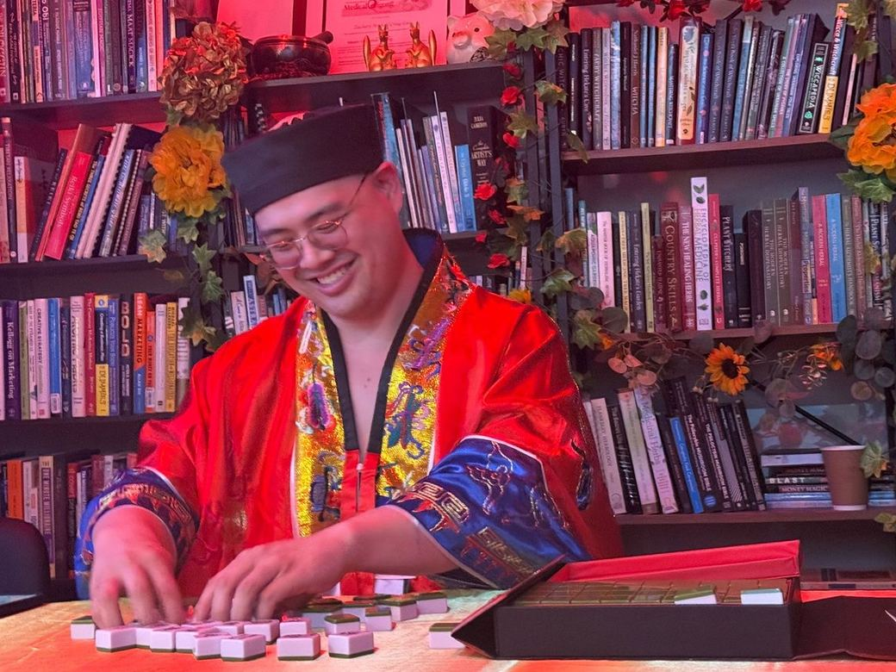

# The Secret Menu

## Work the medicine you already practise

You say qi, shen and the five phases all day. Ask how they work and the explanation hits a floor, somewhere around the year the textbook was written.

In The Secret Menu you work the rest of it, for yourself, in your own life, one operation at a time, live with me on Zoom.

\$75 CAD a month + tax, \$84.75 in total. Cancel any time.

[Join The Secret Menu →](https://buy.stripe.com/3cI8wObD81C38vkg9b3Nm0w)

## What you get

- One live class a month on Zoom, about an hour, on an operation from the Index.
- The recording of every class, yours while you stay subscribed.
- Every new monograph after garlic. They go to members only. Garlic is 24 pages on one herb, sources itemised edition by edition, and it's [free with the Index](/free-index) so you can see the format first.

Class dates go out by email at least seven days ahead. Recordings and monographs land in a members' folder, sent to the email you join with.

## In the library

- **Class 1, September 2026: The Two States, Mapping Yin and Yang.**
- **Class 2, October 2026: Ghost Road 01, 鬼宮 (Ghost Palace), with the primer.** The context for working the Thirteen Ghost Points from Sun Simiao's formulary. Recording released in November.
- **Coming in November: Ghost Road 02, 鬼信 (Ghost Trust).**

October opened the series **Walking the Ghost Road: The 13 Ghost Points of Sun Simiao**, one point per class in his order. Each class gives the etymology of the point's name, maps the state it holds, and works that state for inner transformation. Every class in the Secret Menu works this way: map the state, then work it.

Join and every recording in the library is yours.

## What the classes work

The Index has nine entries: divination, correspondence, talismans, energy work, gnosis, illumination, banishing, spirit work and the ninth. Every class takes one operation from that list and works it.

OPERATIONS_MAP_DIAGRAM

Every claim carries its source, edition named.

## Who teaches it

Zachary Lui, 巫 (Wu shaman) and Daoist priest by transmission. He carries 茅山上清 (Mao Shan Shangqing) and 正一 (Zhengyi) Daoist transmission, received from the late Robert Youngs in 2020, and works 唐密 (Tangmi), Chinese Esoteric Buddhism. His spiritual master is Andrieh Vitimus, and he has been apprenticing since 2008.

Benebell Wen names him in her 2026 essay [Are Asian Folk Traditions "Pagan"?](https://benebellwen.com/2026/02/19/are-asian-folk-traditions-pagan/) as a practitioner of Buddhist ritual magic and shamanism.

LINEAGE_CHART_DIAGRAM

## The rate

The first 20 members at \$75 keep that rate for as long as they stay subscribed. After 20, the price goes up for new members, and checkout shows it before you pay.

To cancel, email zac@zacharylui.ca with the subject line "Cancel" and every future charge stops. [Full terms](/terms).

[Join The Secret Menu →](https://buy.stripe.com/3cI8wObD81C38vkg9b3Nm0w)

Want to read before you join? [The Index is free](/free-index).

*This is education and energy practice, for your own use, not medical treatment or diagnosis. Nothing here replaces care from your doctor. No specific results are promised.*
